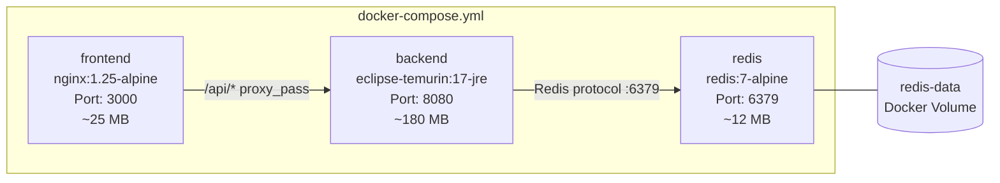
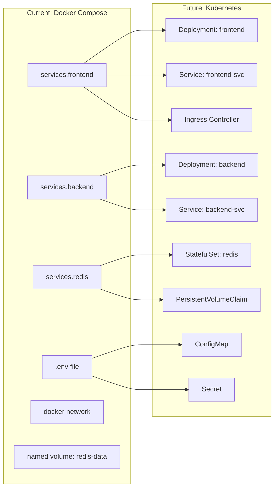

# System Architecture & Technical Design Specification

This document details the architectural blueprint for the AI Hackathon unified platform, specifying module boundaries, frontend/backend communication, persistence trade-offs, security, containerization strategy, and Kubernetes migration path.

---

## 🏗️ High-Level System Topology

The platform consists of a **single unified React frontend** communicating over JSON REST APIs with a **single Java Spring Boot backend**. The application is structured into four functional modules coordinated through a shared landing page. Each service is independently containerized with Docker, composed via Docker Compose, and designed for future Kubernetes migration without architectural changes.

```mermaid
flowchart TB
    subgraph ClientBrowser [Browser Client]
        subgraph ReactApp [Unified React 18+ Application]
            LP[Landing Page & Global Health Dashboard]
            Nav[Module Router & Shared Nav]
            M1_UI[1. Smart Dimming Scheduler UI]
            M2_UI[2. Solar Deployment Evaluator UI]
            M3_UI[3. Solar Issue Forecaster UI]
            M4_UI[4. Self-Service Troubleshooter UI]
            AuthCtx[Shared Auth & Session State]
        end
    end

    subgraph DockerNetwork ["Docker Internal Network (hackathon-net)"]

        subgraph FrontendContainer ["frontend (Nginx :3000)"]
            NginxProxy[Nginx Reverse Proxy & Static Serve]
        end

        subgraph BackendContainer ["backend (Spring Boot :8080)"]
            SecFilter[Spring Security - Basic Auth Filter]
            Dispatcher[Spring MVC REST Controller Layer]
            
            subgraph ModuleAPIs [Module API Controllers]
                C1[/api/v1/schedules/*]
                C2[/api/v1/deployment/*]
                C3[/api/v1/forecast/*]
                C4[/api/v1/troubleshoot/*]
            end

            subgraph ServiceEngines [Business Logic & AI Engines]
                S1[Natural Language Scheduler & TALQ Exporter]
                S2[Solar Feasibility & NREL Yield Simulator]
                S3[Telemetry Anomaly & Battery SoH Predictor]
                S4[Interactive Diagnostic State Machine & Copilot]
            end

            subgraph DataAccessLayer [Data Abstraction Layer]
                RepoAdapter[Repository Adapter Interface]
            end

            HealthEndpoint["/actuator/health (Liveness & Readiness)"]
        end

        subgraph RedisContainer ["redis (Redis 7 :6379)"]
            RedisStore[(Redis AOF + RDB Persistent Store)]
            RedisVolume[("Volume: redis-data")]
        end
    end

    subgraph ExternalServices [External Integrations]
        NASA_API[NASA POWER Solar API]
        NREL_API[NREL PVWatts V8 API]
    end

    ClientBrowser -->|HTTPS :3000| NginxProxy
    NginxProxy -->|Proxy /api/* to backend:8080| SecFilter
    SecFilter --> Dispatcher
    Dispatcher --> ModuleAPIs
    C1 --> S1
    C2 --> S2
    C3 --> S3
    C4 --> S4

    S1 & S2 & S3 & S4 --> RepoAdapter
    RepoAdapter -->|Primary: Redis Keys/Hashes| RedisStore
    RedisStore --- RedisVolume
    S2 -.->|Solar irradiance lookups| NASA_API & NREL_API
```

---

## 🧩 Module Boundaries & API Contracts

Each module maintains strict bounded-context isolation within the backend package structure while sharing common security, configuration, and data-access adapters. This modular separation enables future extraction into independent microservices with minimal refactoring.

| Module | Core Purpose | Primary API Endpoints | Data Managed |
| :--- | :--- | :--- | :--- |
| **Scheduler** | Simplifies dimming schedule creation via natural language input and visual curves. | `POST /api/v1/schedules/generate`<br>`GET /api/v1/schedules`<br>`POST /api/v1/schedules/{id}/deploy` | Schedule templates, calendar events, dimming profiles, energy savings calculations. |
| **Deployment Evaluator** | Evaluates target GPS coordinates for solar device suitability, shading loss, and autonomy days. | `POST /api/v1/deployment/evaluate`<br>`GET /api/v1/deployment/history` | Site coordinates, solar irradiation metrics ($kWh/m^2/day$), load profiles, feasibility score. |
| **Issue Forecaster** | Detects multivariate anomalies in solar device telemetry; predicts battery degradation ($SoH$). | `GET /api/v1/forecast/devices`<br>`GET /api/v1/forecast/devices/{id}/telemetry`<br>`POST /api/v1/forecast/analyze` | Time-series telemetry (voltage, current, temperature, lux), anomaly scores, predicted failure window. |
| **Troubleshooter** | Guides users through interactive step-by-step resolution of device malfunctions. | `POST /api/v1/troubleshoot/start`<br>`POST /api/v1/troubleshoot/step`<br>`GET /api/v1/troubleshoot/session/{id}` | Active diagnostic sessions, fault decision trees, guided steps, resolution logs. |

### Future Microservice Extraction Path
If scaling beyond hackathon scope, individual modules can be extracted into separate Spring Boot applications by:
1. Moving each `com.hackathon.platform.<module>` package into its own Maven module or repository.
2. Replacing direct in-process service calls with REST or event-driven messaging (e.g., Spring Cloud Stream / RabbitMQ).
3. Each extracted microservice retains its own Dockerfile, health endpoint, and Redis namespace or dedicated persistence.
4. The frontend `nginx.conf` routes are updated to map `/api/v1/<module>/*` to the respective microservice container.

No architectural changes are required in the PoC phase to preserve this migration path—the clean package boundaries and repository adapter pattern already enforce it.

---

## 💾 Persistence Strategy & Trade-Off Analysis

### The Hackathon Challenge
The architecture must avoid heavy, slow relational database migrations (PostgreSQL/MySQL setups) while ensuring the PoC can be started effortlessly and withstand restarts without losing demo state.

### Persistence Evaluation Matrix

| Strategy | Advantages | Risks & Failure Modes | Restart & Data Loss Mitigation | PoC Verdict |
| :--- | :--- | :--- | :--- | :--- |
| **Pure In-Memory Collections** (Java `ConcurrentHashMap`) | Zero external dependencies; instant startup; ideal for rapid testing. | Process restart wipes all generated schedules, evaluated sites, and troubleshooting sessions. | None (ephemeral). Requires re-seeding bootstrap data on every boot. | Acceptable only as a fallback tier. |
| **Redis In-Memory Key-Value / Hashes** | Ultra-fast; supports TTL, key eviction, structured data (`HSET`, `ZSET` for time-series telemetry); matches modern microservices. | By default, Redis is memory-first. If Redis crashes or restarts without persistence configuration, data is lost. | **Mitigation:** Enable **Redis AOF (Append-Only File)** with `appendfsync everysec` and **RDB snapshots** (`save 60 1`). | **Recommended Primary Choice** |
| **File-Backed JSON Repository** (Jackson / JSON files in local `./data/` directory) | Zero external server required (runs standalone without Redis installed); 100% persistent across JVM restarts; easy to inspect/edit with text editor. | Slower under high write concurrency (not an issue for PoC demonstration); file locking complexities if multi-threaded. | Writes atomic temporary files before replacing (`write-then-rename`). Perfect demo repeatability. | **Recommended Dual-Mode Fallback** |

### PoC Hybrid Persistence Design
To ensure anyone evaluating the PoC can run it seamlessly **with or without a running Redis server**, the backend implements a polymorphic repository:
1. If `spring.data.redis.host` is available and connects successfully, Redis is used as the active storage engine with AOF durability.
2. If Redis is unreachable, the backend automatically falls back to an embedded **File-Backed JSON Store** in `./data/seed/` with zero configuration needed.

### Redis Container Persistence Configuration
When running via Docker Compose, the Redis container is configured for durable storage:
```yaml
# Excerpt from docker-compose.yml
redis:
  image: redis:7-alpine
  command: redis-server --appendonly yes --appendfsync everysec --save 60 1
  volumes:
    - redis-data:/data    # Named volume survives container restarts and rebuilds
  healthcheck:
    test: ["CMD", "redis-cli", "ping"]
    interval: 10s
    timeout: 3s
    retries: 5
```

**Restart implications:** Data in the `redis-data` Docker volume survives `docker compose stop`, `docker compose restart`, and even `docker compose down`. Data is only lost on `docker compose down -v` (which explicitly removes named volumes). This is clearly documented in `.env.example`.

---

## 🔒 Authentication & Security Model

### PoC Implementation
For the hackathon PoC, enterprise complexity (OAuth2 / Keycloak / SAML) is omitted in favor of **Spring Security HTTP Basic Authentication**:
* **Session Handling:** Stateless HTTP Basic Auth sent via standard `Authorization: Basic <base64>` header stored in browser session storage.
* **Security Scope:** Prevents unauthorized REST invocation while keeping frontend-backend integration lightweight and testable with standard `curl` or Postman.

### Externalized Credentials
Credentials are **never hardcoded** in source code. They are injected via environment variables and documented in `.env.example`:
```env
# .env.example — copy to .env and set real values
ADMIN_USERNAME=admin
ADMIN_PASSWORD=HackAI2026!
TECH_USERNAME=tech
TECH_PASSWORD=TechField2026!
```

The Spring Boot `application.yml` reads these via `${ADMIN_USERNAME:admin}` syntax, falling back to defaults only in local development mode.

### Security Limitations (Documented)
* Basic Auth transmits credentials in Base64 (not encrypted). In production, enforce HTTPS/TLS termination.
* No role-based access control (RBAC) beyond two user tiers (admin / tech). Future production would introduce Spring Security OAuth2 Resource Server.
* Redis is accessed without ACL authentication in the PoC; production should enable `requirepass` and TLS.
* The `.env` file must never be committed to Git. A `.gitignore` entry is included.

---

## 🐳 Containerization Architecture

### Design Principles
* **Build once, run anywhere:** Multi-stage Dockerfiles produce optimized, minimal images with no build toolchain residue.
* **Environment-driven configuration:** All credentials, feature flags, ports, and external API keys are externalized into `.env` / environment variables.
* **Health observability:** Every service exposes health checks consumed by Docker Compose (and future Kubernetes probes).
* **Minimal coupling:** The frontend only knows the backend via `VITE_API_BASE_URL`; the backend only knows Redis via `SPRING_DATA_REDIS_HOST`. Swapping implementations requires zero code changes.

### Container Inventory



| Container | Base Image | Build Strategy | Exposed Port | Health Check | Size (approx) |
| :--- | :--- | :--- | :--- | :--- | :--- |
| `frontend` | `node:18-alpine` → `nginx:1.25-alpine` | Multi-stage: npm build → copy dist to Nginx | `3000` | `curl -f http://localhost:3000/` | ~25 MB |
| `backend` | `maven:3.9-eclipse-temurin-17` → `eclipse-temurin:17-jre-alpine` | Multi-stage: Maven package → copy JAR to JRE | `8080` | `curl -f http://localhost:8080/actuator/health` | ~180 MB |
| `redis` | `redis:7-alpine` | Pre-built official image | `6379` | `redis-cli ping` | ~12 MB |

### Frontend Dockerfile Design
```dockerfile
# --- Stage 1: Build ---
FROM node:18-alpine AS build
WORKDIR /app
COPY package*.json ./
RUN npm ci --production=false
COPY . .
ARG VITE_API_BASE_URL=/api
ENV VITE_API_BASE_URL=${VITE_API_BASE_URL}
RUN npm run build

# --- Stage 2: Serve ---
FROM nginx:1.25-alpine
COPY --from=build /app/dist /usr/share/nginx/html
COPY nginx.conf /etc/nginx/conf.d/default.conf
EXPOSE 3000
HEALTHCHECK --interval=30s --timeout=3s CMD curl -f http://localhost:3000/ || exit 1
```

### Backend Dockerfile Design
```dockerfile
# --- Stage 1: Build ---
FROM maven:3.9-eclipse-temurin-17 AS build
WORKDIR /app
COPY pom.xml .
RUN mvn dependency:go-offline -B
COPY src ./src
RUN mvn package -DskipTests -B

# --- Stage 2: Runtime ---
FROM eclipse-temurin:17-jre-alpine
WORKDIR /app
RUN addgroup -S appgroup && adduser -S appuser -G appgroup
COPY --from=build /app/target/*.jar app.jar
RUN mkdir -p /app/data/seed && chown -R appuser:appgroup /app
USER appuser
EXPOSE 8080
HEALTHCHECK --interval=30s --timeout=5s CMD curl -f http://localhost:8080/actuator/health || exit 1
ENTRYPOINT ["java", "-jar", "app.jar"]
```

### Nginx Reverse Proxy Configuration
The frontend Nginx instance serves static React assets and proxies API calls to the backend container, eliminating CORS complexity:
```nginx
server {
    listen 3000;
    server_name localhost;
    root /usr/share/nginx/html;
    index index.html;

    # SPA client-side routing: serve index.html for all non-file routes
    location / {
        try_files $uri $uri/ /index.html;
    }

    # Reverse proxy API calls to Spring Boot backend
    location /api/ {
        proxy_pass http://backend:8080/api/;
        proxy_set_header Host $host;
        proxy_set_header X-Real-IP $remote_addr;
        proxy_set_header X-Forwarded-For $proxy_add_x_forwarded_for;
        proxy_set_header X-Forwarded-Proto $scheme;
    }

    # Proxy Actuator health for backend monitoring
    location /actuator/ {
        proxy_pass http://backend:8080/actuator/;
    }
}
```

---

## 🖥️ Shared Landing Page & UX Flow

The frontend landing page acts as an operational command center:
1. **Header & Status Bar:** Global system health, active device count, energy conservation counter, connected storage indicator (Redis vs Local).
2. **Four Hero Module Cards:**
   * **Schedule Optimizer:** Quick statistics on active schedules, one-click prompt bar ("Create 40% midnight dimming for Park Avenue"), visual preview.
   * **Solar Siting Evaluator:** Mini-map / coordinate entry with instant "Feasibility Index" gauge.
   * **Failure Forecaster:** High-risk devices alert banner (e.g., "3 devices showing rapid battery degradation").
   * **Self-Service Diagnostics:** Interactive symptom search ("Pole #104 light stays off", "Battery drained before 2 AM").
3. **Seamless Module Navigation:** Instant transitions with preserved state across modules.

---

## ☸️ Kubernetes Migration Path (Future — Not PoC Scope)

The Docker Compose architecture is deliberately designed for minimal-friction Kubernetes migration. No K8s manifests are included in the PoC to avoid premature orchestration complexity. This section documents the changes needed.

### Mapping Docker Compose to Kubernetes Primitives



### Required Changes for Kubernetes

| Aspect | Docker Compose (Current) | Kubernetes (Future) | Migration Effort |
| :--- | :--- | :--- | :--- |
| **Frontend** | `services.frontend` with port mapping | `Deployment` + `ClusterIP Service` + `Ingress` with TLS termination | Low |
| **Backend** | `services.backend` with `depends_on` | `Deployment` + `ClusterIP Service`; readiness/liveness probes already defined via `/actuator/health` | Low |
| **Redis** | `services.redis` with named volume | `StatefulSet` + `PersistentVolumeClaim` with storage class | Medium |
| **Secrets** | `.env` file | `Secret` objects (base64-encoded or sealed-secrets) | Low |
| **Configuration** | Environment variables in `.env` | `ConfigMap` for non-sensitive values, `Secret` for credentials | Low |
| **Networking** | Docker bridge network | Default namespace networking or `NetworkPolicy` | Low |
| **Health Checks** | Docker `HEALTHCHECK` instructions | `livenessProbe` and `readinessProbe` in pod spec (same HTTP endpoints) | Trivial |
| **Scaling** | Manual `docker compose up --scale` | `HorizontalPodAutoscaler` with CPU/memory targets | Medium |
| **Image Registry** | Local `docker compose build` | Push to container registry (GCR, ECR, Docker Hub) and reference in manifests | Low |

### Key Kubernetes Decisions (Deferred)
* **Ingress Controller Selection:** Nginx Ingress Controller or cloud-native (GKE Ingress, ALB Ingress Controller). TLS certificates via cert-manager.
* **Redis Strategy:** Managed Redis (Cloud Memorystore, ElastiCache) vs self-hosted StatefulSet. Managed is recommended for production to avoid operational overhead.
* **Namespace Strategy:** Single `hackathon` namespace for PoC workloads; future environment separation via `hackathon-dev`, `hackathon-staging`, `hackathon-prod`.
* **CI/CD Pipeline:** GitHub Actions or Cloud Build creating container images on merge, deploying to staging, and promoting to production on approval.
