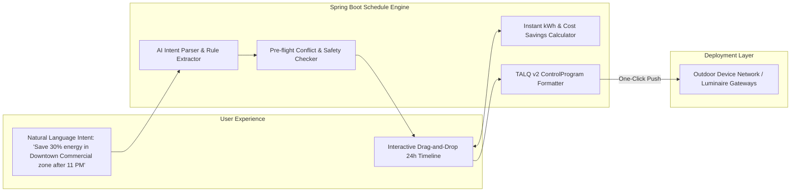
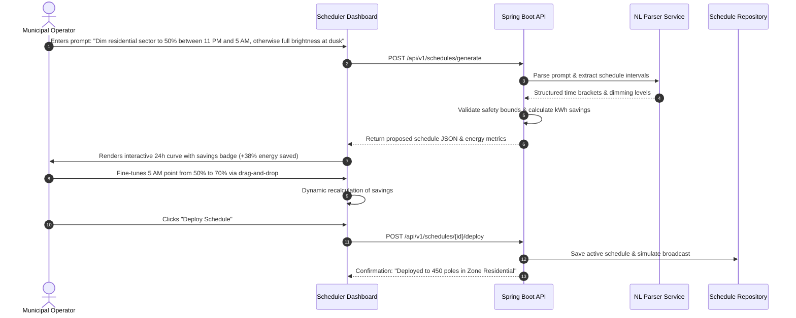

# Problem 01: Dimming Schedule Configuration Enhancement

## 1. Challenge & Context Overview
* **Domain:** Smart Lighting Central Management Software (CMS) / Outdoor Device Networks (ODN).
* **Target PoC Module:** `Scheduler`
* **Problem Statement:** The existing dimming schedule configuration and push process involves multiple steps, making it challenging for users to create, configure, and deploy schedules efficiently.
* **Core Challenge:** How can we make the dimming schedule configuration and deployment process simpler, more intuitive, and less time-consuming?

---

## 2. Problem, Stakeholders & Business Impact
* **Primary Stakeholders:**
  * **Municipal Lighting Operators & Smart City Administrators:** Manage lighting schedules across thousands of street poles; responsible for night safety and municipal carbon reduction goals.
  * **Commercial Facility Managers:** Oversee corporate campuses, logistics yards, and parking lots seeking to minimize electricity utility bills.
  * **Field Commissioning Technicians:** Tasked with pushing and verifying initial schedule programs onto newly installed luminaires.
* **Current Workflow Pain Points:**
  * Multi-window navigation: Setting up a single schedule often requires defining time slots, setting astronomical clock offsets (e.g., sunset + 20 mins), configuring calendar exceptions (holidays, festivals), binding luminaire groups, and running manual push commands.
  * Error-prone manual math: Calculating whether a dimming profile violates regional pedestrian illuminance standards (e.g., EN 13201 or IES RP-8) or estimating the actual dollar and kilowatt-hour ($kWh$) savings requires spreadsheet side-calculations.
  * High cognitive barrier: Junior staff hesitate to modify schedules due to fear of inadvertently turning off critical arterial roadway lighting.
* **Business Impact:**
  * Up to 25–40% missed energy savings due to operators leaving conservative, non-dimmed schedules active rather than navigating cumbersome scheduling tools.
  * Hours wasted per schedule revision, creating delays in municipal responsiveness to energy price spikes or curfew regulations.

---

## 3. Existing Solutions & Opportunity Gaps

| Solution | Mechanism | Limitations |
| :--- | :--- | :--- |
| **Traditional CMS Wizards** (e.g., legacy SCADA, Signify Interact, Schréder EXEDRA) | Multi-step modal wizards requiring manual time-bracket definition, slider percentage entry, and group mapping. | Slow; 8–15 clicks per schedule; zero real-time guidance on energy or safety trade-offs. |
| **Astronomical Time Clocks** | Hardware photocells or astronomical timers wired directly into electrical feeder panels. | Rigid; lacks remote flexibility; cannot dynamically adjust brightness or respond to special events. |
| **Motion-Triggered Sensor Dimming** (Radar/PIR Zhaga sensors) | Autonomous dim-to-bright ramping based on detected pedestrian/vehicle presence. | Higher hardware cost per fixture; still requires baseline schedule definitions for quiescent periods. |

### Opportunity Gap
No commercial CMS natively offers a **Semantic Schedule Copilot** that converts conversational, policy-level business intent (e.g., *"Reduce arterial lights to 40% after midnight, keep school zones at 100% until 9 PM, and ensure full compliance with EN 13201"*) into validated, conflict-free, standard-compliant (TALQ/DALI-2) schedules with instant visual energy and cost feedback.

---

## 4. Recommended Solution & Architectural Design

### Concept: The "Natural Intent" Dimming Schedule Studio
The solution pairs an **AI-assisted Natural Language Schedule Parser** with an **Interactive Visual Curve Editor** and a **Pre-flight Compliance & Energy Simulation Engine**.



### Key Differentiators & AI Justification
* **Natural Language Intent Extraction:** Uses lightweight NLP / LLM prompting to translate free-form text or policy documents into structured JSON time-brackets and dimming levels.
* **Why AI vs Pure RegEx?** Free-form operator instructions use varied terminology ("curfew mode", "dusk till dawn", "school hours", "midnight step-down"). An LLM robustly parses complex relative temporal expressions and intent that brittle RegEx cannot handle.
* **Instant Energy Impact Modeling:** When an operator drags a point on the visual curve or types a prompt, the system instantly computes expected daily $kWh$ savings and metric tons of $CO_2$ reduced against a 100% burn baseline.
* **Pre-flight Safety Bounds:** The deterministic rule engine guarantees safety: AI cannot lower lighting below mandatory regulatory thresholds (e.g., min 30% on public streets).

### Data Contracts & TALQ v2 Payload Structure
```json
{
  "programId": "prog-downtown-eco-01",
  "programName": "Downtown Energy Saver - Midnight Cut",
  "targetZone": "ZONE_DOWNTOWN_COMMERCIAL",
  "luminaireCount": 240,
  "ratedPowerWattsPerPole": 120,
  "timePoints": [
    { "triggerType": "ASTRONOMICAL", "offsetMinutes": 15, "event": "SUNSET", "dimmingLevelPercent": 100 },
    { "triggerType": "ABSOLUTE_TIME", "time": "22:00", "dimmingLevelPercent": 70 },
    { "triggerType": "ABSOLUTE_TIME", "time": "00:00", "dimmingLevelPercent": 40 },
    { "triggerType": "ABSOLUTE_TIME", "time": "05:00", "dimmingLevelPercent": 80 },
    { "triggerType": "ASTRONOMICAL", "offsetMinutes": -15, "event": "SUNRISE", "dimmingLevelPercent": 0 }
  ],
  "simulationMetrics": {
    "baselineDailyKwh": 316.8,
    "optimizedDailyKwh": 182.4,
    "dailySavingsPercent": 42.4,
    "monthlyCostSavingsUsd": 604.80
  }
}
```

---

## 5. User Journey & Example Scenarios



---

## 6. Assumptions, Risks & Mitigations
* **Assumption:** The CMS has predefined astronomical sunrise/sunset tables or coordinates to resolve astro-clock offsets. *(Verified: standard practice in TALQ and DALI CMS platforms)*.
* **Risk (AI Hallucination):** The LLM might generate illegal dimming percentages (e.g., -10% or 150%) or conflicting overlapping times.
  * **Mitigation:** Strict deterministic post-parsing validator: any time-interval overlap is automatically flagged, and values are clamped strictly between 0% and 100%.
* **Risk (Network Push Delay):** Real-world mesh networks (Wi-SUN / LoRaWAN) can experience packet loss during bulk schedule distribution.
  * **Mitigation (PoC Scope):** Clearly indicate deployment status progression (`Draft` -> `Validated` -> `Broadcasting` -> `Confirmed`).

---

## 7. MVP Scope & Hackathon Implementation Plan

* **Included in PoC:**
  * Natural language prompt bar with one-click sample presets ("Midnight Energy Cut", "Weekend Late Night", "Festival Mode").
  * Real-time interactive 24-hour visual curve showing time of day vs dimming percentage (0–100%).
  * Instant energy ($kWh$), cost (\$), and $CO_2$ savings calculator updated dynamically on curve adjustment.
  * Conflict & validation checker (warns if lighting is dimmed too low during high-traffic evening hours).
  * One-click mock deployment with TALQ v2 JSON export.
* **Deferred to Future Production:**
  * Hardware gateway mesh re-transmission retries and physical luminaire over-the-air firmware verification.

---

## 8. Why This Solution Could Win: Evaluation

1. **Meaningful Difference:** Replaces a 10-step tedious configuration wizard with a 10-second conversational prompt and an intuitive visual curve that instantly visualizes financial ROI.
2. **Business Impact:** Directly cuts schedule configuration time by over 80% and unlocks up to 35% in municipal energy savings by eliminating the friction of seasonal schedule optimization.
3. **Hackathon Feasibility:** Highly feasible in a single React canvas/SVG timeline component backed by a deterministic Java Spring Boot rule engine.
4. **Compelling Demo:** In 30 seconds, an operator types a simple natural language prompt, watches the timeline curve draw itself, sees the energy savings counter tick up, tweaks a slider, and deploys it with a single click.
5. **AI Justification:** AI acts as a smart translation bridge from policy language to protocol code, eliminating user manual calculations without replacing deterministic safety limits.
6. **Weaknesses & Trade-offs:** Lacks direct integration with actual city traffic radar cameras; energy savings are simulated based on nominal fixture wattage rather than live weather-compensated metering.
7. **Strongest Advantage:** Instant visual feedback combined with TALQ v2 industry-standard schema compliance.

*Honest Assessment: High feasibility, strong visual demo appeal, addresses a genuine day-to-day pain point in smart city operations.*
