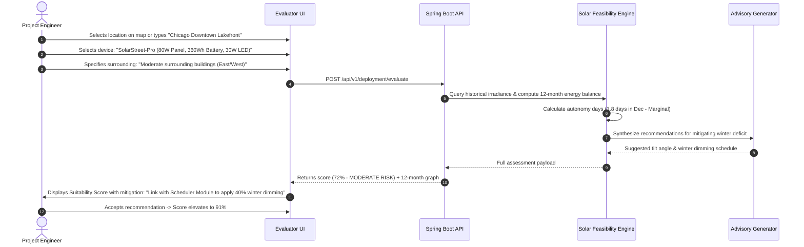

# Problem 02: Solar Device Deployment Assessment

## 1. Challenge & Context Overview
* **Domain:** Solar-Powered IoT Infrastructure (Smart Streetlights, Solar Environmental Stations, CCTV Poles).
* **Target PoC Module:** `Deployment Evaluator`
* **Problem Statement:** Deploying a solar-powered device at a particular location involves several factors that can influence its performance and reliability. Evaluating these factors before installation can be complex and requires careful consideration.
* **Core Challenge:** How can we help users make informed decisions about solar device installation at a given location while considering the factors that influence deployment suitability and long-term performance?

---

## 2. Problem, Stakeholders & Business Impact
* **Primary Stakeholders:**
  * **Solar Project Engineers & Planners:** Responsible for sizing solar panels and battery storage to prevent seasonal outages.
  * **Sales & Solutions Engineers:** Need rapid, defensible feasibility quotes for prospective municipal and commercial clients without waiting weeks for full manual engineering surveys.
  * **Field Installation Contractors:** Require clear on-site orientation guidelines (optimal tilt, azimuth, clearance from tree canopies or tall structures).
* **Current Workflow Pain Points:**
  * Disjointed calculation tools: Engineers combine generic solar maps (e.g., PVWatts), spreadsheet formulas, and manual Google Earth satellite inspections to guess local shading and seasonal deficits.
  * Blind spot on autonomy: Devices frequently pass generic sunny-day calculations but fail catastrophically during the winter solstice or during extended monsoonal/cloudy stretches.
  * Lack of hardware-specific tuning: Off-the-shelf calculators don't account for specific IoT device characteristics (e.g., vertical vs angled pole mounting, LiFePO4 battery cold-temperature cutoffs, nighttime dimming load profiles).
* **Business Impact:**
  * Under-sizing leads to "dark poles", battery deep-discharge damage, and warranty replacement disputes costing thousands of dollars per site.
  * Over-sizing inflates hardware costs by 40–60%, causing lost tender bids to competitors.

---

## 3. Existing Solutions & Opportunity Gaps

| Solution | Methodology | Limitations |
| :--- | :--- | :--- |
| **NREL PVWatts / SAM** | Mathematical simulation using typical meteorological year (TMY3) data. | Built for fixed rooftop or utility solar; lacks IoT load curves (nighttime lighting), pole physics, and automated installation recommendations. |
| **Manual Site Survey (SunEye / Sky-Cam)** | Technicians visit the site physically with fish-eye lens optical tools to map tree/building horizon blockages. | High cost (\$300–\$800 per pole location); impractical for multi-mile municipal projects with hundreds of proposed pole locations. |
| **Vendor Rules of Thumb** (e.g., "Always use 100W panel and 50Ah battery everywhere") | Static hardware sizing across entire geographic regions. | Guarantees under-performance in northern latitudes/shadow zones and massive waste in equatorial regions. |

### Opportunity Gap
A unified **Automated Solar Deployment Assessment Engine** that takes GPS coordinates and proposed device profiles, fetches high-resolution solar irradiance metrics (NASA POWER / NREL), applies localized shading and temperature penalties, models the 365-day energy balance, and generates a plain-English **Deployment Suitability Index (0–100%)** with specific installation instructions.

---

## 4. Recommended Solution & Architectural Design

### Concept: The "SolarFit" Feasibility Engine
The engine models the physical energy balance at any target coordinate:
$$E_{\text{daily\_harvest}} = P_{\text{panel}} \times \text{PSH} \times \eta_{\text{temp}} \times \eta_{\text{soiling}} \times (1 - \text{ShadingLoss})$$
$$E_{\text{daily\_consumed}} = \sum (P_{\text{load\_mode}} \times t_{\text{hours}})$$
$$\text{Autonomy Days} = \frac{C_{\text{battery\_usable}} (Wh)}{E_{\text{daily\_consumed}} (Wh)}$$

```mermaid
flowchart TD
    UserInputs["User Inputs: GPS Coordinates, Device BOM Profile, Shading Context"]
    
    subgraph SitingEngine [Spring Boot Deployment Evaluator]
        GeoResolver[Reverse Geocoder & Climate Zone Classifier]
        SolarFetcher[Solar Irradiance Fetcher (NASA POWER / TMY)]
        SeasonalSim[365-Day Daily Energy Balance Simulator]
        AutonomyCalc[Battery Autonomy & Winter Deficit Analyzer]
        RiskScorer[Multi-Factor Suitability Scorer]
        AIAssistant[AI Installation Advisor & Tilt Optimizer]
    end

    subgraph OutputReports [Comprehensive Assessment Report]
        FeasibilityScore["Suitability Index: 88% (EXCELLENT)"]
        MonthlyChart["12-Month Generation vs Consumption Graph"]
        RiskWarnings["Warning: Winter solstice deficit requires 30% midnight dimming"]
        InstallGuide["Recommended Orientation: 28° Tilt, 185° Azimuth (South)"]
    end

    UserInputs --> GeoResolver
    GeoResolver --> SolarFetcher
    SolarFetcher --> SeasonalSim
    SeasonalSim --> AutonomyCalc
    AutonomyCalc --> RiskScorer
    RiskScorer --> AIAssistant
    AIAssistant --> FeasibilityScore & MonthlyChart & RiskWarnings & InstallGuide
```

### Key Differentiators & AI Justification
* **365-Day Seasonal Deficit Modeling:** Rather than using annual averages that hide winter blackouts, the engine simulates month-by-month worst-case performance (e.g., December/January in the Northern Hemisphere).
* **AI-Assisted Site Recommendation:** An LLM synthesizes complex meteorological parameters (cloud cover indexes, monsoon windows, optimal tilt vs latitude) into actionable, conversational site advice for non-technical field planners.
* **Smart Dimming Co-Optimization:** If a site is marginally unviable (e.g., 68% score), the engine automatically suggests the exact dimming schedule from Problem 01 needed to make the site 100% sustainable.

### API Contract Example
```json
{
  "location": {
    "latitude": 37.7749,
    "longitude": -122.4194,
    "cityName": "San Francisco, CA"
  },
  "deviceConfig": {
    "panelWattage": 100,
    "batteryCapacityWh": 480,
    "batteryChemistry": "LIFEPO4",
    "ledWattage": 40,
    "dimmingProfile": "ECO_MIDNIGHT_STEPDOWN"
  },
  "shadingCondition": "PARTIAL_URBAN_CANOPY",
  "assessmentResult": {
    "suitabilityScore": 84,
    "feasibilityTier": "HIGHLY_FEASIBLE",
    "annualAveragePsh": 4.82,
    "worstMonthPsh": 2.65,
    "worstMonthName": "December",
    "estimatedAutonomyDays": 3.4,
    "recommendedTiltDegrees": 32,
    "recommendedAzimuthDegrees": 180,
    "seasonalDeficitRisk": "LOW",
    "recommendations": [
      "Optimal orientation is true South (180°) with a 32° fixed angle for balanced winter yield.",
      "Tree canopy to the east will cause minor morning attenuation; midday peak is unobstructed.",
      "Battery capacity (480 Wh) provides 3.4 days of overcast autonomy, satisfying municipal SLA."
    ]
  }
}
```

---

## 5. User Journey & Example Scenarios



---

## 6. Assumptions, Risks & Mitigations
* **Assumption:** Macro-solar irradiance data (NASA POWER or localized TMY data) accurately reflects regional sun patterns. *(Verified: standard meteorological engineering practice)*.
* **Risk (Micro-Shading Inaccuracy):** Satellite data cannot see a specific tree branch directly overhanging an individual pole.
  * **Mitigation:** The UI provides an explicit "Obstruction & Shading Selector" (Open Sky, Low Foliage, Tall Urban Corridor, Extreme Shadow) that applies scientifically calibrated attenuation penalties (0% to 55% loss).
* **Risk (Over-Optimistic Autonomy):** Assuming 100% battery depth of discharge can cause premature battery death.
  * **Mitigation:** The simulator enforces conservative chemical limits (LiFePO4 max 85% DoD, Lead-Acid max 50% DoD).

---

## 7. MVP Scope & Hackathon Implementation Plan

* **Included in PoC:**
  * Interactive location selector (preset test cities across distinct climate zones: Sunny Equatorial, Northern Winter, Moderate Coastal).
  * Configurable device parameters (panel $W_p$, battery $Wh$, luminaire load).
  * Shading factor selector with calibrated derating curves.
  * 12-month interactive energy production vs consumption bar/line chart.
  * Suitability Gauge (0–100) with color-coded safety tiers.
  * AI-generated actionable installation checklist (tilt, azimuth, expected autonomy).
* **Deferred to Future Production:**
  * Drone 3D point-cloud LiDAR ingestion for automated millimeter-level tree branch shadow tracing.

---

## 8. Why This Solution Could Win: Evaluation

1. **Meaningful Difference:** Bridges the gap between academic solar simulators (PVWatts) and actual commercial IoT hardware deployment, adding automated winter risk analysis.
2. **Business Impact:** Prevents costly pole relocation (\$1,200 per pole) and saves sales engineers 2–3 hours per proposal while giving customers confidence in uptime SLAs.
3. **Hackathon Feasibility:** Well-scoped; leverages reliable solar equations and verified benchmark data for instant responsiveness.
4. **Compelling Demo:** Switching between a sunny site (Phoenix, AZ) and a challenging site (Seattle, WA in December) instantly reveals how winter deficits are flagged and how adjusting tilt or dimming cures the deficiency in real time.
5. **AI Justification:** Translates complex multi-variable solar physics into plain-English installation directives that field contractors can understand without an engineering degree.
6. **Weaknesses & Trade-offs:** Relies on user-declared shading categories rather than automated on-site camera imagery.
7. **Strongest Advantage:** Cross-module synergy—directly feeds into the Scheduler (Problem 01) to automatically resolve solar power deficits.

*Honest Assessment: Highly practical, strong visual impact with 12-month charts, grounded in rigorous physics.*
