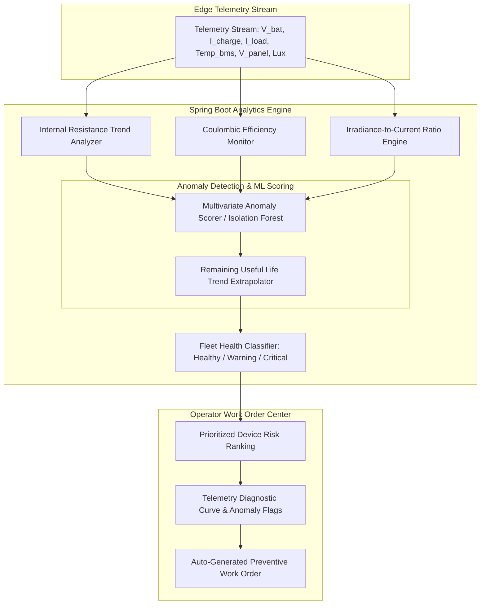
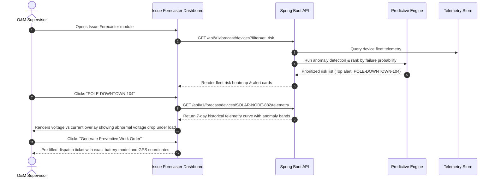

# Problem 03: Solar Device Issue Prediction

## 1. Challenge & Context Overview
* **Domain:** Predictive Maintenance & IoT Device Health Telemetry.
* **Target PoC Module:** `Issue Forecaster`
* **Problem Statement:** Solar-powered devices may experience unexpected failures or performance degradation due to various environmental, technical, and operational factors. Identifying potential issues before they occur is challenging, often resulting in unexpected downtime and reduced device reliability.
* **Core Challenge:** How can we predict potential solar device issues before they occur, enabling proactive action to minimize unexpected failures and operational disruptions?

---

## 2. Problem, Stakeholders & Business Impact
* **Primary Stakeholders:**
  * **Operations & Maintenance (O&M) Supervisors:** Manage field repair teams, dispatch schedules, and replacement inventory.
  * **Asset Owners (Municipalities, Utilities, Facility Owners):** Penalized by service-level agreement (SLA) breaches when lights go dark or solar CCTV systems shut down.
  * **Device Warranty & Support Engineers:** Need to distinguish between defective battery batches, environmental extreme events, and vandalism/theft.
* **Current Workflow Pain Points:**
  * Reactive firefighting: Technicians only learn a device has failed after a citizen logs a complaint or a nocturnal security patrol reports a blackout.
  * Late threshold triggers: By the time a low-voltage battery alarm fires ($V_{\text{battery}} < 10.5V$), the battery is already in irreversible deep discharge, permanently damaging cells.
  * No root-cause visibility: Operators see a generic "Offline" status without knowing whether the root cause is a blown fuse, severe panel soiling, thermal runaway, or internal battery impedance spike.
* **Business Impact:**
  * Emergency truck rolls cost \$300–\$600 per dispatch, often requiring specialized aerial bucket trucks.
  * Unplanned battery replacements shorten asset lifespan from an expected 7–10 years down to 3–4 years, inflating capital expenditure (CapEx) by over 100%.

---

## 3. Existing Solutions & Opportunity Gaps

| Solution | Working Mechanism | Limitations |
| :--- | :--- | :--- |
| **Static Threshold Monitoring** (Standard SCADA / BMS) | Triggers alerts when voltage drops below a static limit or temperature exceeds $55^\circ\text{C}$. | High false alarms; fails to detect gradual degradation; alerts too late for preventive intervention. |
| **Periodic Manual Inspection Patrols** | Technicians inspect poles once every 6–12 months. | Highly labor-intensive; cannot detect transient electronic faults or rapid battery cell deterioration between cycles. |
| **Raw Telemetry Dashboards** (e.g., standard Grafana) | Displays time-series graphs of voltage and current. | Overwhelms operators with charts without identifying which 5 poles out of 2,000 need urgent attention this week. |

### Opportunity Gap
A **Multivariate Telemetry Forecaster** that continuously tracks battery State of Health ($SoH$), internal resistance ($R_{\text{int}}$) escalation, and solar charging ratio deviations to predict impending failures **7 to 14 days before dark-pole blackout**, scoring risk from 0 to 100 and suggesting targeted preventive work orders.

---

## 4. Recommended Solution & Architectural Design

### Concept: The "SolarGuard" Predictive Telemetry Forecaster
The system monitors four core degradation vectors across incoming device telemetry:
1. **Internal Resistance Spike ($R_{\text{int}}$):**
   $$R_{\text{int}} = \frac{V_{\text{open\_circuit}} - V_{\text{under\_load}}}{I_{\text{load}}}$$
   A progressive upward trend in $R_{\text{int}}$ indicates battery electrolyte dry-out or cell degradation.
2. **Coulombic Charging Efficiency ($\eta_{\text{coulomb}}$):**
   $$\eta = \frac{\int I_{\text{discharge}} dt}{\int I_{\text{charge}} dt}$$
   A decaying ratio indicates parasitic internal self-discharge or short circuits.
3. **Panel Irradiance-to-Current Conversion Ratio:**
   $$\text{Ratio} = \frac{I_{\text{panel\_actual}}}{P_{\text{rated\_panel}} \times (\text{AmbientLux} / 100000)}$$
   A persistent drop during clear midday peaks indicates heavy panel soiling, dust accumulation, or cracked glass.
4. **Thermal Stress Accumulation:** Operating hours exceeding $45^\circ\text{C}$ modeled via Arrhenius degradation factor.



### Telemetry Payload Schema
```json
{
  "deviceId": "SOLAR-NODE-882",
  "poleNumber": "POLE-DOWNTOWN-104",
  "location": { "lat": 37.779, "lon": -122.418 },
  "telemetrySnapshot": {
    "timestamp": "2026-10-18T00:30:00Z",
    "batteryVoltage": 11.4,
    "batteryCurrentAmps": -2.8,
    "batteryTempCelsius": 42.1,
    "panelVoltage": 0.0,
    "panelCurrentAmps": 0.0,
    "ambientLux": 0.2,
    "stateOfChargePercent": 34
  },
  "predictiveHealthAnalysis": {
    "healthStatus": "CRITICAL_WARNING",
    "healthScore": 41,
    "predictedFailureWindowDays": 6,
    "primaryFailureMode": "BATTERY_IMPEDANCE_DEGRADATION",
    "estimatedStateOfHealthPercent": 62,
    "anomalyConfidence": 0.89,
    "diagnosticSummary": "Steep voltage collapse observed upon load activation (ΔV = 1.6V at 2.8A, R_int = 0.57Ω vs nominal 0.08Ω). Battery cells nearing end-of-life.",
    "recommendedAction": "Schedule battery replacement within 5 business days. Do not wait for complete blackout."
  }
}
```

---

## 5. User Journey & Example Scenarios



---

## 6. Assumptions, Risks & Mitigations
* **Assumption:** The device telemetry stream reports battery voltage, current, and temperature at regular intervals (e.g., 5 to 60 minutes). *(Verified: standard across modern MPPT charge controllers and IoT BMS nodes)*.
* **Risk (False Positives from Weather):** A stretch of 3 consecutive heavily overcast days could be mistaken for solar panel failure.
  * **Mitigation:** The engine cross-correlates panel current with ambient lux and external weather data. If ambient lux is low across the entire regional cluster, the alert is classified as "Weather Attenuation" rather than "Hardware Soiling/Defect".
* **Risk (Noisy Telemetry Transients):** Sudden load switching spikes causing false anomaly alerts.
  * **Mitigation:** Telemetry undergoes exponential smoothing ($EMA$) and multi-cycle persistence checks (anomaly must persist across 3 consecutive cycles) before raising a critical maintenance ticket.

---

## 7. MVP Scope & Hackathon Implementation Plan

* **Included in PoC:**
  * Fleet Health Dashboard displaying mock fleet of 20+ solar devices categorized by health tier (Healthy, Early Warning, Critical).
  * Interactive device inspector with 7-day simulated time-series charts (Voltage, Current, Temperature, SoC).
  * Three distinct simulated failure modes demonstrated in data:
    1. **Battery Impedance Degradation:** Rapid voltage drop under night load.
    2. **Solar Panel Soiling / Shading:** Midday solar current lagging 50% below clear-sky potential.
    3. **Thermal Distress / Fan Failure:** Battery temperature hovering persistently above $50^\circ\text{C}$.
  * AI-generated diagnostic explanation and remaining useful life (RUL) prediction.
  * One-click "Preventive Work Order" generation.
* **Deferred to Future Production:**
  * Real-time automated edge firmware retraining on embedded microcontrollers.

---

## 8. Why This Solution Could Win: Evaluation

1. **Meaningful Difference:** Shifts operations from blind reactive dispatch (waiting for citizen complaints) to predictive proactive replacement 7–14 days in advance.
2. **Business Impact:** Cuts emergency truck roll costs by up to 50% through batched scheduled maintenance, and prolongs battery fleet lifespan by preventing irreversible deep discharges.
3. **Hackathon Feasibility:** Clean, manageable data models; time-series graphs and anomaly detection algorithms (Isolation Forest / resistance formulas) are easily demonstrable with realistic simulated telemetry.
4. **Compelling Demo:** Comparing a healthy device curve against a failing device curve instantly illustrates the abnormal voltage droop under load, making the AI's prediction undeniable to both technical judges and business stakeholders.
5. **AI Justification:** Multivariate anomaly detection recognizes subtle cross-variable correlations (voltage drop relative to current and temperature) that static single-variable threshold alerts completely miss.
6. **Weaknesses & Trade-offs:** Predictive accuracy depends on consistent telemetry; battery chemistry specifics ($\text{LiFePO}_4$ flat discharge curves) require precise voltage resolution.
7. **Strongest Advantage:** Real-world ROI with immediate financial justification for municipal and commercial fleet operators.

*Honest Assessment: High business value, visually impressive time-series visualizations, highly credible engineering foundation.*
