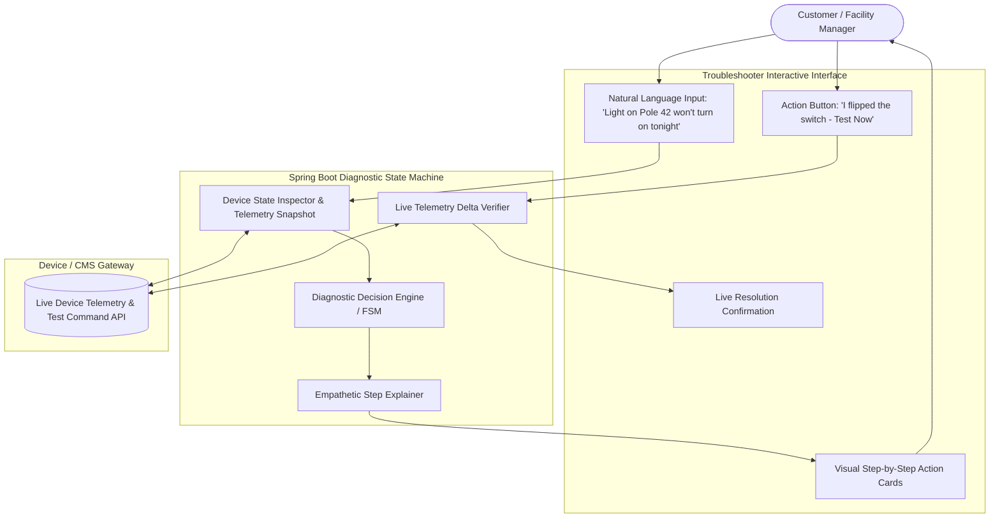
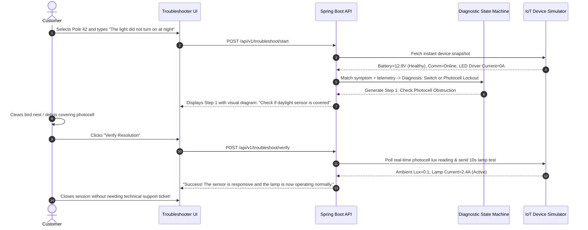

# Problem 04: Self-Service Troubleshooting

## 1. Challenge & Context Overview
* **Domain:** Customer & Field Self-Service Diagnostics / Interactive Troubleshooting.
* **Target PoC Module:** `Troubleshooter`
* **Problem Statement:** Customers often encounter common device-related issues that require technical assistance, even when the issues could potentially be addressed through basic troubleshooting steps. Identifying the appropriate initial actions without technical expertise can be challenging, leading to increased support dependency and resolution time.
* **Core Challenge:** How can we enable customers to independently identify and perform initial troubleshooting steps for common device issues before seeking technical support?

---

## 2. Problem, Stakeholders & Business Impact
* **Primary Stakeholders:**
  * **End Customers & Facility Managers:** Non-technical operators who observe lighting or device failures and need fast resolution without waiting days for a ticket response.
  * **Field Electricians & Subcontractors:** Junior technicians performing initial site checks who need guided procedures rather than reading 200-page service manuals.
  * **OEM Technical Support / Helpdesk Teams:** Tier-1 and Tier-2 support engineers burdened by repetitive inquiries that could have been resolved on-site in 2 minutes.
* **Current Workflow Pain Points:**
  * Support queue delays: Customers submit tickets via email or web portals; average initial response time ranges from 12 to 48 hours.
  * Fragmented static knowledge: Troubleshooting guides exist as dense PDF manuals or static FAQ pages that users rarely read or struggle to map to their specific symptoms.
  * Unverified customer actions: Support agents ask "Did you check the breaker?", customer replies "Yes", but neither party has a way to verify device telemetry response in real time.
* **Business Impact:**
  * High Tier-1 support operating costs (\$25–\$45 per logged support ticket).
  * Unnecessary on-site dispatch costs when a simple physical switch, dirty photocell, or misconfigured schedule was the sole culprit.
  * Customer frustration and perceived unreliability of the IoT smart system.

---

## 3. Existing Solutions & Opportunity Gaps

| Solution | Mechanism | Limitations |
| :--- | :--- | :--- |
| **Static PDF Manuals & Knowledge Base** | Searchable FAQs and wiring diagrams. | Static, impersonal, technical jargon; non-technical customers abandon search after 1 minute. |
| **Generic AI Chatbots** (Intercom / Zendesk bots) | RAG or LLM chatbot answering questions from text manuals. | "Blind" to hardware state: cannot query real-time device telemetry, cannot verify if a step worked, offers generic advice. |
| **Remote SCADA Overrides** | Central operator manually triggers diagnostic commands. | Requires customer to call the central operator, defeating self-service autonomy. |

### Opportunity Gap
A **Context-Aware Diagnostic Copilot** that marries a conversational LLM with **live hardware telemetry inspection** and an **interactive verification loop**:
1. When a user reports a symptom, the copilot immediately pulls the device's live telemetry (battery voltage, charging current, light output state, communication ping).
2. It pinpoints the most probable fault branch (e.g., physical vs software vs environmental).
3. It guides the user through step-by-step visual actions and executes **live test pings** to confirm whether the user's action resolved the problem.

---

## 4. Recommended Solution & Architectural Design

### Concept: The "DiagCopilot" Telemetry-Guided Assistant
The diagnostic engine blends a deterministic finite state machine (FSM) for safety-critical hardware steps with an LLM conversational layer for intuitive, empathetic user interaction.



### Key Differentiators & AI Justification
* **Live Telemetry Grounding:** Unlike generic chatbots that hallucinate troubleshooting advice, DiagCopilot anchors every response to real telemetry:
  * If $V_{\text{battery}} = 13.2V$ and $V_{\text{panel}} = 0V$ (night) but lamp is off, it checks CMS schedule overrides before asking the user to check wiring.
  * If $V_{\text{battery}} = 10.2V$ (deeply depleted), it avoids asking the user to inspect the LED driver and immediately guides them to solar panel obstruction checks.
* **Interactive Verification Ping:** After the user executes a step (e.g., clearing leaves off the solar panel or resetting the isolator), the user clicks "Verify Resolution". The backend queries the device's real-time delta. If charging current jumps from $0A$ to $3.2A$, the issue is verified resolved instantly!
* **Automated Escalation with Rich Diagnostic Context:** If the guided steps fail, the system automatically packages a pre-triaged support ticket containing the exact steps taken, telemetry logs, and probable failed component, saving Tier-2 engineers 30 minutes of diagnostic interrogation.

### API Contract Example
```json
{
  "sessionId": "diag-sess-9021",
  "deviceId": "SOLAR-NODE-882",
  "symptom": "LAMP_DOES_NOT_TURN_ON_AT_DUSK",
  "currentState": "STEP_CHECK_ISOLATOR_SWITCH",
  "deviceTelemetrySnapshot": {
    "batteryVoltage": 12.8,
    "panelVoltage": 0.0,
    "reportedLampState": "COMMANDED_ON_BUT_ZERO_CURRENT",
    "cmsConnection": "ONLINE"
  },
  "stepDetails": {
    "stepNumber": 1,
    "totalEstimatedSteps": 3,
    "title": "Inspect Lower Pole Physical Isolator Switch",
    "instructions": "Locate the waterproof access hatch 1.5 meters from the base of Pole 42. Check if the red rotary isolator switch is set to position '1' (ON).",
    "safetyWarning": "Do not open internal electrical junction box without certified PPE.",
    "actionType": "PHYSICAL_INSPECTION_AND_VERIFY"
  },
  "status": "WAITING_FOR_USER_ACTION"
}
```

---

## 5. User Journey & Example Scenarios



---

## 6. Assumptions, Risks & Mitigations
* **Assumption:** Basic device telemetry and online/offline status can be queried on-demand. *(Verified: standard capability in cellular, NB-IoT, and Wi-SUN smart lighting gateways)*.
* **Risk (Customer Safety):** Non-technical users attempting hazardous high-voltage electrical repairs.
  * **Mitigation:** The system strictly restricts self-service instructions to low-risk, ground-level actions (inspecting isolator switch, clearing ground vegetation, verifying CMS schedules, rebooting gateway). Anything involving opening high-voltage drivers or climbing poles immediately triggers a "Professional Service Required" safety gate.
* **Risk (Ambiguous Symptoms):** User provides vague input ("It looks weird").
  * **Mitigation:** The copilot presents a visual symptom picker (e.g., "Completely Dark", "Flickering", "Turns Off Early", "Stays On During Day") alongside the conversational input bar.

---

## 7. MVP Scope & Hackathon Implementation Plan

* **Included in PoC:**
  * Multi-turn interactive diagnostic wizard (React component with progress stepper).
  * Symptom auto-complete and natural language problem description input.
  * Live telemetry state inspector showing current device vitals before troubleshooting begins.
  * 3 complete end-to-end guided troubleshooting flows:
    1. **Photocell / Sensor False Daylight Lockout:** Debris on sensor tricking device into thinking it is daytime.
    2. **Physical Isolator Switch Open:** Battery fully charged, but ground disconnect switch tripped.
    3. **Schedule Conflict / Dimming Override:** Lamp commanded off by an unintended high-priority CMS calendar event.
  * Interactive "Verify Resolution" button that queries simulated hardware state to validate resolution.
  * Automated escalation button that generates a pre-formatted Jira/ServiceNow style ticket if self-service fails.
* **Deferred to Future Production:**
  * Augmented Reality (AR) camera overlay pointing at physical pole components.

---

## 8. Why This Solution Could Win: Evaluation

1. **Meaningful Difference:** Unlike generic FAQ chatbots, this assistant is directly wired into live hardware telemetry and features an active verification loop that tests the physical device.
2. **Business Impact:** Solves the #1 cost driver for smart lighting operators: unnecessary truck rolls and Tier-1 ticket congestion, resolving up to 35% of issues without technician dispatch.
3. **Hackathon Feasibility:** Exceptional demo feasibility; the step-by-step interactive workflow with live telemetry state changes is immediately intuitive and visually engaging.
4. **Compelling Demo:** The user reports a dark light, the system pulls telemetry, reveals that the battery is full but the sensor is locked out, guides the user to click a virtual reset/clean action, and the telemetry dashboard instantly lights up green with verified current flow.
5. **AI Justification:** Uses AI for natural language empathy, symptom understanding, and dynamic contextual explanation, while retaining a deterministic state machine for safety and diagnostic accuracy.
6. **Weaknesses & Trade-offs:** Cannot resolve true internal component failures (e.g., burned-out LED diode string); relies on user honesty for physical checks.
7. **Strongest Advantage:** Instant gratification for the user and immediate cost savings for the support organization.

*Honest Assessment: Exceptionally high demo appeal, clear human value, and perfect hackathon story arc.*
