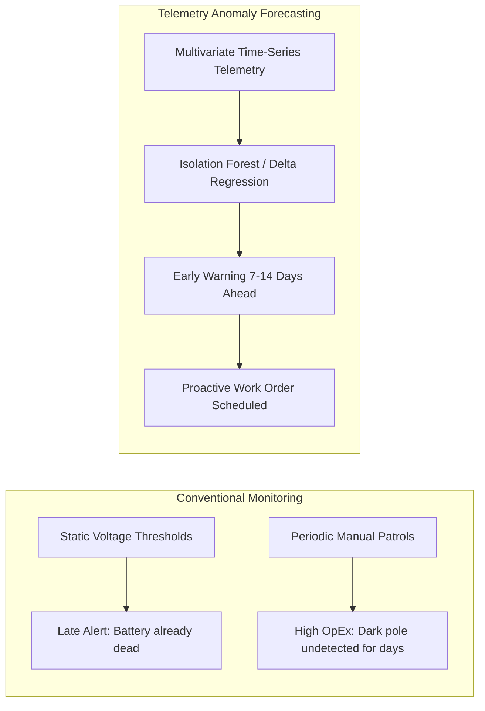

# Cross-Domain Industry Research, Standards & Vendor Comparisons

This document synthesizes independent research across smart lighting Central Management Systems (CMS), solar photovoltaic engineering, IoT battery degradation physics, and automated field diagnostics.

---

## 💡 Domain 1: Smart Lighting CMS & Dimming Schedules

### 1. Industry Standards Landscape
Large-scale outdoor lighting networks connect hundreds of thousands of luminaires across municipalities. Three standards define the modern ecosystem:
* **TALQ Consortium (TALQ v2):** An international standard defining an application-level REST/JSON protocol between Central Management Systems (CMS) and Outdoor Device Networks (ODN). TALQ prevents vendor lock-in by standardizing how dimming schedules, astronomical clock triggers, calendar programs, and luminaire telemetry are transferred across diverse hardware gateways.
* **Zhaga Book 18:** Standardizes the physical 4-pin mechanical and electrical receptacle on luminaire heads, allowing toolless insertion of smart IoT communication nodes and sensors.
* **DALI-2 & D4i (IEC 62386):** Standardizes intra-luminaire digital communication. D4i enables the LED driver to report energy consumption ($\pm 1\%$), internal temperature, and operating hours back up through the Zhaga node to the CMS.

### 2. Commercial Vendor Comparison

| Vendor / Platform | Architecture & Strengths | Scheduling Limitations | Opportunity Gap for AI |
| :--- | :--- | :--- | :--- |
| **Signify Interact City** | Market leader; robust multi-tiered calendar rules, astronomical clock integration, dynamic radar motion dimming. | Complex multi-step GUI; requires manual entry of time brackets, lux thresholds, and individual luminaire group bindings. High operator training barrier. | Natural Language to TALQ schedule generation; automated compliance and energy savings pre-calculation. |
| **Schréder EXEDRA** | Open ecosystem based on TALQ; strong asset management and geographical zone clustering. | Rule creation remains static; lacks predictive recommendations for energy-saving schedule adjustments based on traffic patterns. | Context-aware schedule tuning based on historical road usage and astronomical transitions. |
| **Telensa PLANet** | Ultra-narrowband RF system installed across millions of streetlights; reliable bulk command dispatch. | Rigid scheduling workflows; modifying schedules across sub-zones requires multi-stage deployment wizards. | Instant semantic schedule configuration with real-time conflict checking. |

---

## ☀️ Domain 2: Solar IoT Siting & Deployment Assessment

### 1. Scientific & Engineering Principles
A solar-powered IoT device (e.g., all-in-one solar streetlamp, solar surveillance node, environmental gateway) is constrained by the energy balance equation:
$$E_{\text{harvested}} \ge E_{\text{consumed}} + E_{\text{losses}}$$
* **Solar Insolation / Peak Sun Hours (PSH):** Measured in $kWh/m^2/day$. Insolation varies wildly by latitude, season, and atmospheric conditions (e.g., winter vs summer insolation ratios often exceed 3:1 in non-equatorial regions).
* **Autonomy Days ($A_{\text{days}}$):** The number of consecutive overcast/rainy days the device can operate purely on stored battery capacity without shutting down:
  $$A_{\text{days}} = \frac{C_{\text{battery}} (Wh) \times \text{Depth-of-Discharge (DoD)}}{E_{\text{daily\_load}} (Wh)}$$
* **Shading & Horizon Blockage:** Obstructions (trees, surrounding buildings, overpasses) cause catastrophic energy loss because partial shading on a solar string can reduce output by 50–80% due to diode bypass behavior.

### 2. Available Benchmark Tools & APIs

| Tool / API | Provider | Capabilities | Limitations for IoT Pole Deployment |
| :--- | :--- | :--- | :--- |
| **NASA POWER API** | NASA Langley Research Center | Free global historical satellite meteorology; GHI, diffuse solar radiation, ambient temperature, humidity over 30+ years. | Spatial resolution ($0.5^\circ \times 0.5^\circ \approx 50km$) misses micro-urban shading and localized obstructions. |
| **NREL PVWatts V8** | National Renewable Energy Laboratory | Industry gold-standard solar yield simulation; calculates monthly AC/DC output based on system capacity, tilt, and losses. | Designed primarily for rooftop and utility-scale solar arrays; lacks pole-mounted vertical battery thermal coupling. |
| **Global Solar Atlas / Solargis** | World Bank / Solargis | High-resolution GIS solar mapping and bankable irradiation estimates. | Commercial licensing barrier; focused on large solar farms rather than distributed edge IoT devices. |

---

## 🔋 Domain 3: Solar Device Issue Prediction & Telemetry Anomaly Detection

### 1. Battery Degradation Mechanics ($\text{LiFePO}_4$ vs Lead-Acid)
Solar IoT devices deployed outdoors endure severe environmental stress:
* **State of Health (SoH):** Defined as the ratio of current maximum usable capacity to rated nameplate capacity:
  $$\text{SoH} = \frac{C_{\text{actual}}}{C_{\text{rated}}} \times 100\%$$
* **Internal Resistance ($R_{\text{int}}$) Spikes:** As lithium-ion/LiFePO4 cells degrade, electrolyte drying and solid-electrolyte interphase (SEI) growth increase internal resistance. When the LED or transmission radio turns on, the sudden current draw ($\Delta I$) triggers a sharp terminal voltage drop ($\Delta V = \Delta I \times R_{\text{int}}$).
* **Thermal Stress & Arrhenius Acceleration:** Operating battery temperatures exceeding $45^\circ\text{C}$ double the chemical degradation rate for every $10^\circ\text{C}$ elevation, while charging below $0^\circ\text{C}$ causes permanent lithium plating.
* **Panel Soiling & MPPT Tracking Degradation:** Dust and bird droppings accumulate gradually, manifesting as a diverging ratio between theoretical open-circuit voltage ($V_{oc}$) and actual operating power point current ($I_{mp}$).

### 2. Predictive Maintenance Techniques

* **Heuristics vs Machine Learning:**
  * Simple thresholds fail because battery voltage fluctuates naturally with ambient temperature and instantaneous load.
  * An unsupervised **Isolation Forest** or **Multivariate Regression** model evaluates $(V, I, T, \text{Lux}, \text{SoC})$ jointly, identifying when battery discharge curves deviate from normal seasonal signatures long before total failure.

---

## 🛠️ Domain 4: Self-Service Troubleshooting & Guided Field Diagnostics

### 1. Operational Realities in Municipal & Customer Support
* **The "Truck Roll" Dilemma:** Dispatching an electrician with a bucket truck costs \$200–\$500 per site visit. Up to 40% of field visits reveal trivial, non-hardware issues:
  1. Tripped breaker or physical isolator switch left open during routine pole painting.
  2. Dirt/leaves completely obstructing the photocell or solar panel.
  3. Luminaire assigned to an incorrect CMS dimming calendar or daylight-saving timezone.
  4. Loose Zhaga connector socket requiring a simple quarter-turn twist.
* **The "Black Box" Chatbot Failure:** Generic LLM chatbots fail in hardware support because they cannot inspect real-time device telemetry. Telling a customer "check your wiring" without knowing if the device is currently receiving solar voltage frustrates the user.

### 2. High-Value Solution: Context-Aware Telemetry-Guided Copilot
By fusing the **current live telemetry snapshot** (e.g., $V_{\text{panel}} = 0V$, $V_{\text{battery}} = 12.8V$, $\text{CMS Status} = \text{Online}$) with a deterministic diagnostic decision tree and an empathetic conversational assistant:
1. The system eliminates guessing by inspecting the device state first.
2. It generates clear, jargon-free inspection steps matched to the exact telemetry signature.
3. It performs a **live verification poll** ("Turn on test light now") to confirm whether the customer's physical intervention resolved the issue before closing the ticket.
